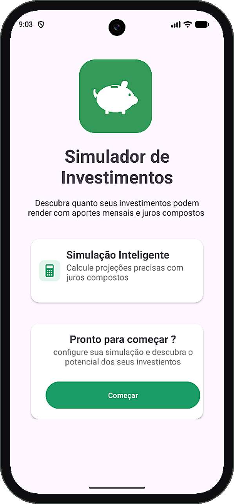
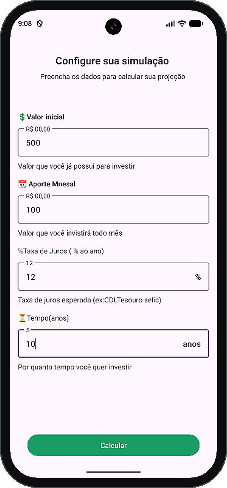
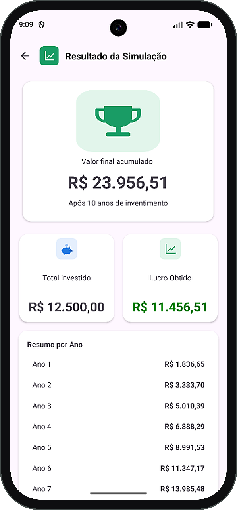

# 💰 Simulador de Investimentos

Aplicativo Android, feito em **Kotlin**, que simula quanto um investimento pode render com **aportes mensais** e **juros compostos**.

Projeto desenvolvido como desafio da escola **Nova Era Tech**.

---

## 📱 Telas

| Tela inicial | Configuração | Resultado |
|:---:|:---:|:---:|
|  |  |  |
| Boas-vindas e botão para começar | Preenchimento dos dados da simulação | Valor final, total investido e lucro |

---

## ✨ Como funciona

1. Na **tela inicial**, a pessoa toca em **Começar**.
2. Na tela de **configuração**, informa:
   - **Valor inicial**: quanto já tem para investir
   - **Aporte mensal**: quanto vai investir todo mês
   - **Taxa de juros** (% ao ano)
   - **Tempo** (em anos)
3. Ao tocar em **Calcular**, o app mostra o **resultado**:
   - **Valor final acumulado**
   - **Total investido**
   - **Lucro obtido** (o quanto veio dos juros)
   - **Resumo por ano**, com a evolução do valor acumulado

### Exemplo

Com **R$ 500** de valor inicial, **R$ 100** de aporte mensal, **12% ao ano** durante **10 anos**:

| Valor final | Total investido | Lucro obtido |
|:---:|:---:|:---:|
| R$ 23.956,51 | R$ 12.500,00 | R$ 11.456,51 |

---

## 🛠️ Tecnologias e componentes

- **Kotlin**
- **Android Studio**
- ConstraintLayout
- ScrollView
- CardView
- LinearLayout
- FrameLayout
- ImageView
- Fragment

---

## ▶️ Como executar

1. Clone o repositório:
   ```bash
   git clone https://github.com/DiogoAlves345/Simulador-de-Investimentos-.git
   ```
2. Abra a pasta do projeto no **Android Studio**.
3. Aguarde o **Gradle** sincronizar.
4. Execute em um emulador ou em um celular Android.

---

## 📚 O que aprendi

- Montar telas com diferentes tipos de layout
- Validar os dados digitados pelo usuário
- Fazer o cálculo de juros compostos com aportes mensais
- Usar **Fragment** na prática (a parte de exibir em formato de lista foi o maior desafio e continuo estudando)

---

## 👨‍💻 Autor

**Diogo Alves** — Mobile Developer

Feito com 💚 durante os estudos na **Nova Era Tech**.
